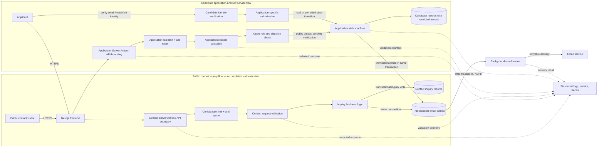

# Proposed Backend Architecture

> This is a recommended design for a contact and recruitment platform. It is not a diagram of Cynbit's verified production systems.

The public application-creation step may remain unauthenticated; it accepts only an application and creates a pending/received state. Email verification or another identity check is appropriate before a candidate can read or change application details. The public contact flow is independent and does not require candidate identity.

## Component responsibilities

- **Next.js frontend:** Progressive form UX and native validation for usability only. Do not expose privileged credentials or trust hidden fields.
- **Server Action/API boundary:** Parse incoming data, enforce request-size and origin expectations, apply abuse controls, and invoke business logic. Next.js actions and any separate API must be treated as public mutation boundaries. If a separate FastAPI service is used, authenticate the server-to-server call; browser CORS is not needed for that hop.
- **Validation layer:** Validate types, lengths, allowed values, URL schemes, collection sizes, and cross-field rules. Validate job state on the server, not from a client-supplied flag.
- **Contact business logic:** Accept an inquiry, apply the contact idempotency policy, and persist it with its email notification event atomically. It has no candidate authentication requirement.
- **Recruitment business logic/state machine:** Check that the role is open, create an application in an explicit initial state, record verification, and allow only valid state transitions.
- **Candidate identity and authorization:** Verify control of the email or account before granting candidate-specific access. Check candidate-to-application ownership and staff roles on every read or mutation.
- **Database:** Keep contact and candidate records in clearly separated tables or schemas with least-privilege access. Use unique constraints for idempotency and business rules, encryption at rest, and stage-based deletion/retention.
- **Outbox and worker:** Persist email events in the same transaction as the inquiry/application state change; deliver asynchronously and retry safely. Do not make acceptance depend on immediate mail-provider availability.
- **Rate limiting / anti-spam:** Use a shared store for multi-instance consistency, route-specific limits, trusted-proxy client identity, and risk-based challenges. Rate limiting does not authenticate an applicant.
- **Logging and monitoring:** Record request ID, route, result code, latency, validation counters, state transitions, and downstream failures. Exclude form bodies and candidate PII; restrict access and retention.

## Data-flow and access boundaries

Application creation can be public while candidate record retrieval remains verified and record-scoped. An opaque application reference or email address alone must not grant access. Public responses should confirm acceptance without revealing whether another application exists for an email. Contact inquiries should be accessible only to staff who handle inquiries and should not share candidate-table permissions by default.
